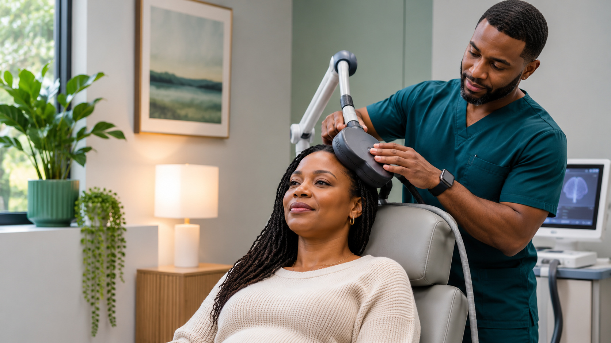

# When depression hasn't improved, your care deserves a second look.

**Patient Education · Marenova Psychiatry & Wellness LLC**

**Programs in development.** Marenova is developing its TMS and Spravato programs. This guide explains what these treatments involve; it does not mean either is available at Marenova now.

**Illustration:** Not an actual Marenova patient, clinician, device, or treatment room.

If treatment has brought too little relief, a useful next step is to review what you have tried, what changed, and what matters most to you. An evaluation can help distinguish between adjusting your current care and considering a different approach.

## What does it feel like?

With TMS, you stay awake. You may hear clicking and feel repeated tapping against your scalp. Some people experience scalp discomfort or headache. Tell the treatment team what you feel so they can assess your comfort and safety. Seizures are rare but serious; screening for risk is part of the evaluation.

Spravato is a nasal medicine, not magnetic stimulation. It can cause sleepiness, dizziness, a feeling of disconnection, increased blood pressure, or breathing problems. The team monitors you during the visit and checks that it is safe for you to leave.

## Can I drive?

**After TMS:** Standard outpatient TMS generally does not require sedation. Many people can drive afterward, but ask your clinician about your symptoms, medications, and individual circumstances before making plans.

**After Spravato:** Arrange a safe ride home before the appointment. Do not drive or operate machinery for the rest of that day or until the next day after restful sleep, even if you feel alert when you leave.

## TMS for depression

Transcranial magnetic stimulation (TMS) uses a coil near the scalp to deliver magnetic pulses to a targeted brain region. It may be an option when previous depression treatment has not provided enough relief. The team reviews your treatment history, medications, seizure risk, and any metal or implanted devices. Treatment usually involves repeated outpatient visits; the schedule depends on the device, protocol, and clinical plan. Improvement is not guaranteed.

## TMS for OCD

Some TMS devices and protocols are FDA-cleared as an adjunctive treatment for obsessive-compulsive disorder. A depression protocol is not automatically an OCD treatment. Ask which system and protocol are being considered and how treatment fits with exposure and response prevention (ERP), medication, and follow-up. TMS is not a replacement for ERP.

## Spravato for treatment-resistant depression

Spravato (esketamine) is a prescription nasal spray for eligible adults. For treatment-resistant depression, it may be prescribed alone or with an oral antidepressant. It is not a take-home treatment.

1. **Before the visit:** The prescriber reviews your health history, medications, blood pressure, risks of abuse or misuse, and transportation plan.
2. **During administration:** You use the nasal spray under direct healthcare supervision in a REMS-certified setting.
3. **Before going home:** Staff monitor you for at least two hours, including breathing and blood pressure, and assess whether you are ready to leave. Some visits require longer observation. A safe ride home is essential.

## What happens next?

An evaluation should leave room for more than one answer. Your clinician may recommend medication review, psychotherapy, attention to sleep or medical contributors, or an advanced treatment. Medication management, TMS, and Spravato are not a mandatory package. Agree on what improvement would look like and when to reassess benefits and side effects.

Coverage and prior authorization vary by plan, indication, and provider. Ask about costs, visit frequency, and current availability before scheduling. This article provides general education, not an individual treatment recommendation.

## Learn more

- [FDA: Spravato prescribing information and Medication Guide](https://www.accessdata.fda.gov/drugsatfda_docs/label/2026/211243s026lbl.pdf)
- [International OCD Foundation: TMS for OCD](https://iocdf.org/about-ocd/treatment/tms/)
- [Research review: adjunctive rTMS for depression](https://pubmed.ncbi.nlm.nih.gov/37501135/)
